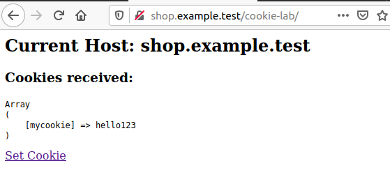
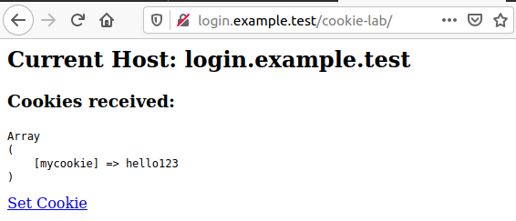
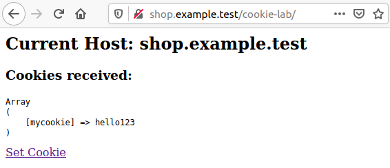
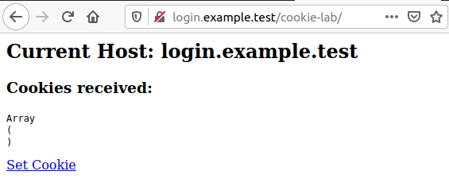

# Demo: Understanding the Cookie Domain Attribute

**Objective:** Understand how the `Domain` attribute controls which hosts can receive a cookie.

## Step 1. Install Apache and PHP

Open a terminal and execute:

```bash
sudo apt update
sudo apt install apache2 php libapache2-mod-php -y
```

## Step 2. Configure Two Hostnames

Edit the hosts file:

```bash
sudo vi /etc/hosts
```

Add the following two entries:

```text
127.0.0.1 shop.example.test
127.0.0.1 login.example.test
```

## Step 3. Create the PHP file

Create a directory for the lab:

```bash
sudo mkdir -p /var/www/html/cookie-lab
```

Create the PHP file:

```bash
sudo vi /var/www/html/cookie-lab/index.php
```

Insert the following code:

```php
<?php

if (isset($_GET['set'])) {
    setcookie("mycookie", "hello123", [
        "expires" => time() + 3600,
        "path" => "/",
        "domain" => "example.test"
    ]);

    echo "Cookie has been set.";
    exit;
}

echo "<h2>Current Host: " . $_SERVER['HTTP_HOST'] . "</h2>";

echo "<h3>Cookies received:</h3>";

echo "<pre>";
print_r($_COOKIE);
echo "</pre>";

?>

<a href="?set=1">Set Cookie</a>
```

Start Apache:

```bash
sudo systemctl enable --now apache2
```

## Step 4. Experiment with the Domain Attribute

Open a browser and perform the following steps:

1. Visit `http://shop.example.test/cookie-lab/`.
2. Click **Set Cookie**.
3. Return to `http://shop.example.test/cookie-lab/` and observe the cookie.
4. Visit `http://login.example.test/cookie-lab/` and observe the cookie again.

**Expected result:**

The cookie is received by both websites because it was set with:

```php
"domain" => "example.test"
```

The browser sends this cookie to the parent domain and its subdomains.

Here is the screenshot results for step 3 and step 4:

Step 3 screenshot:



Step 4 screenshot:



## Step 5. Experiment Without the Domain Attribute

Modify the `setcookie()` call in `index.php`:

```php
setcookie("mycookie", "hello123", [
    "expires" => time() + 3600,
    "path" => "/"
]);
```

The `Domain` attribute has now been omitted.

Before repeating the experiment, clear the existing `mycookie` cookie in your browser's developer tools.

Repeat the steps from Step 4:

1. Visit `http://shop.example.test/cookie-lab/`.
2. Click **Set Cookie**.
3. Visit `http://shop.example.test/cookie-lab/` and observe the cookie.
4. Visit `http://login.example.test/cookie-lab/` and observe the cookie again.

**Expected result:**

- `shop.example.test`: Cookie received.
- `login.example.test`: Cookie not received.

Without the `Domain` attribute, the browser creates a host-only cookie. It is sent only to the host that set it.

Step 3 screenshot:



Step 4 screenshot:



## Questions

1. Why can `login.example.test` receive the cookie when the Domain attribute is `example.test`?
2. What happens when the Domain attribute is omitted?
3. Does sharing a cookie between two subdomains mean they have the same origin?

## Key Takeaway

Setting `Domain=example.test` allows a cookie to be sent to `example.test` and its subdomains.

Omitting the `Domain` attribute creates a host-only cookie, which is restricted to the host that set it.

Sharing cookies between two subdomains does not make them the same origin. The Same-Origin Policy still distinguishes origins by scheme, hostname, and port.
